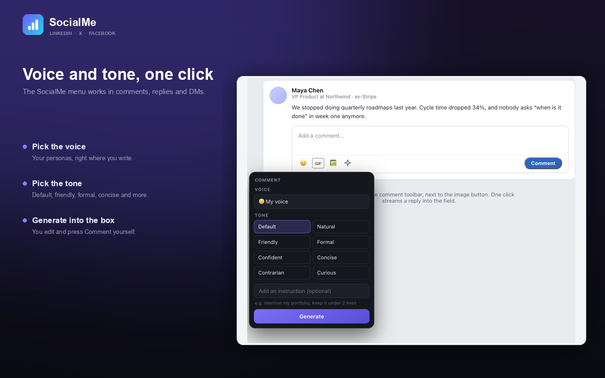

# SocialMe

**Comments, message replies and LinkedIn connection notes in your own voice.**

<p align="center">
  
</p>

<p align="center">
  Chrome Manifest V3 · LinkedIn · X · Facebook · bring your own API key
</p>

Free and open source. No account, no telemetry, no server. Keys stay in your browser.

---

## What it does

| | |
|---|---|
| 💬 **Comment replies** | A ✦ in every comment box. It reads the post, author and headline, then streams a reply into the box. |
| 🧵 **Reply to a comment** | The ✦ in a reply box answers that person, not the post — so threads actually continue. |
| ✉️ **DM replies** | Reads the last 1, 3 or 12 messages and answers the most recent one. |
| 🔗 **Connection notes** | Writes the 300-character LinkedIn invite note from the person's name and headline. |
| 🎭 **Eight voices** | `My voice` is the default; switch to Thought leader, Principal Architect, AI Builder and more. |
| 🎚️ **Voice + tone in one click** | The ✦ menu has a voice selector, tone chips and an optional instruction. |
| 🧠 **Full panel** (`⌘⇧A`) | Eight angles, tone, length, language, quality score, regenerate and recent drafts. |
| 🏷️ **Brand + voice** | Positioning, pillars, proof, POV, writing samples and banned words. It sounds like you. |
| 📏 **Guardrails** | Character caps, no cliché openers, no invented facts, no engagement bait, no forced emoji. |
| 🛡️ **Account safety** | Human-paced typing, hourly/daily caps, warning detection, auto-send off by default. |
| 🔌 **Your provider** | OpenAI, DeepSeek, OpenRouter, Gemini, Anthropic, Ollama or any OpenAI-compatible endpoint. |
| 🔒 **Local-first** | Everything is in `chrome.storage.local`; API keys never reach the page. Export/import any time. |
| 🩺 **Diagnostics** | Composer health for LinkedIn, X and Facebook plus a per-page scan when a platform changes. |

## One click on every surface

<p align="center">
  
</p>

Comment on a post, reply to a comment, answer a DM, or write a LinkedIn invite note. Same icon,
same voice, in the composer you are already using.

## Voice and tone in one click

<p align="center">
  
</p>

Pick the voice and the tone, add an instruction such as “mention the 2-week launch”, then Generate.
The draft lands in the box; you edit it and press Comment yourself.

## Eight voices, one identity

<p align="center">
  
</p>

| Voice | Best for | Tone |
|---|---|---|
| 🙂 My voice | Default, natural comments | Direct and practical |
| 🎯 Thought leader | Architecture, strategy, leadership | Analytical and precise |
| ⚡ Casual peer | Developer conversations, informal threads | Warm and conversational |
| 🏗️ Principal Architect | System design, scalability, trade-offs | Analytical and precise |
| 🤖 AI Builder | Agents, MCP, integrations, automation | Direct and practical |
| 🚀 Product Engineer | Product thinking, startups, business impact | Confident and bold |
| 🔐 Security & Fintech | Payments, crypto, security, reliability | No-nonsense technical |
| 👥 Engineering Mentor | Career growth, mentoring, engineering culture | Humble and curious |

`My voice` is never overwritten by an upgrade. Your edits and user-created voices survive.

[How the voices work](https://github.com/shahzadafridi/socialme/wiki/Voices) ·
[Ready-to-paste examples](https://github.com/shahzadafridi/socialme/wiki/Voice-examples)

## The full panel

<p align="center">
  
</p>

`⌘⇧A` on a post opens the panel: eight angles, tone, length, language, a quality score with
specificity and cliché checks, regenerate with rejected drafts, and recent history.

## Install (2 minutes)

1. Download the latest `socialme-<version>-chrome.zip` from [Releases](../../releases) and unzip it
   somewhere permanent.
2. Open `chrome://extensions` → enable **Developer mode** → **Load unpacked** → select that folder.
3. Click the extension → **Settings** → paste an API key (DeepSeek is the cheapest).
4. In **Brand**, fill *Positioning* and *Content pillars*. That is what makes it sound like you.
5. Reload any LinkedIn / X / Facebook tab.

## Use it

- **Comment** on a post → **✦** → pick a voice and tone → Generate → edit → press Comment.
- **Reply to a comment** → **✦** in that reply box → it answers the commenter.
- **Open a DM** → **✦** in the message toolbar → it answers the last message.
- **Send a connection request** → **Add a note** → **✦** → a 300-character note in your voice.
- **⌘⇧A** opens the panel for angles, tone, length and the quality score.

## Safety and privacy

- Sending is manual by default. Auto-send is opt-in and capped.
- Human-paced typing with punctuation pauses; optional fast/careful profiles.
- Hourly and daily caps, minimum gap between actions, and a pause when the platform shows a warning.
- No analytics, no account, no backend. Only your chosen AI provider receives the request.
- Export/import settings and voices as JSON; API keys are excluded on purpose.

## Documentation

The manual lives in the **[wiki](https://github.com/shahzadafridi/socialme/wiki)**:

- [Voices](https://github.com/shahzadafridi/socialme/wiki/Voices) ·
  [Voice examples](https://github.com/shahzadafridi/socialme/wiki/Voice-examples)
- [Scope](https://github.com/shahzadafridi/socialme/wiki/Scope) ·
  [Architecture](https://github.com/shahzadafridi/socialme/wiki/Architecture) ·
  [Testing](https://github.com/shahzadafridi/socialme/wiki/Testing) ·
  [Publishing](https://github.com/shahzadafridi/socialme/wiki/Publishing) ·
  [Contributing](https://github.com/shahzadafridi/socialme/wiki/Contributing)
- [Privacy policy](./PRIVACY.md)

## Development

```bash
npm install
npm run build      # -> dist/chrome-mv3
npm run test:all   # logic + extension e2e + live flow
```

## Support

If SocialMe saves you time, you can
[buy me a coffee](https://wise.com/pay/business/shahzadahmadltd). I put it towards charity work —
helping people in need with essentials.

Starring the repo helps too, and so does telling me which platform broke first.

MIT licensed. Not affiliated with LinkedIn, X, Meta or any AI provider.
