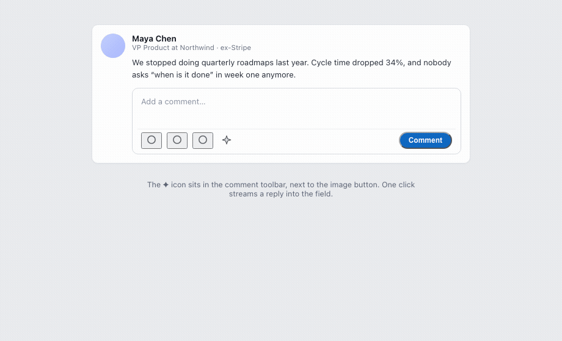
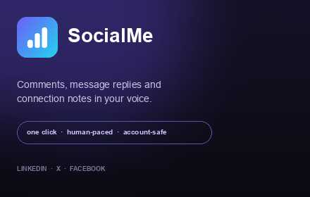
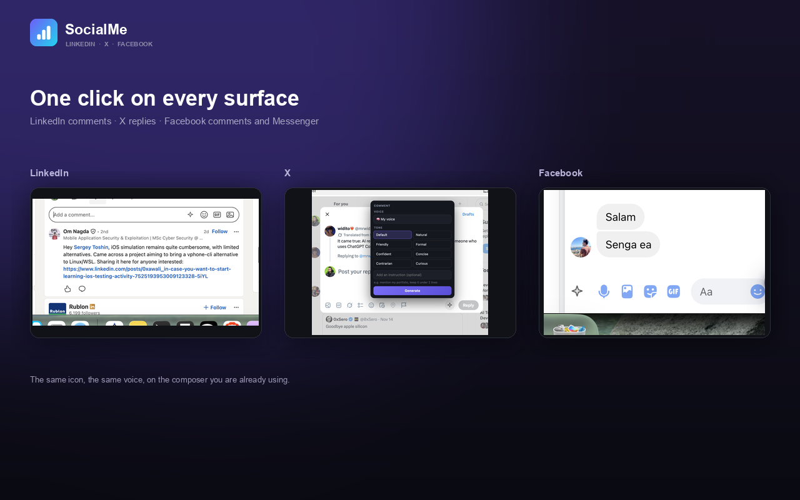
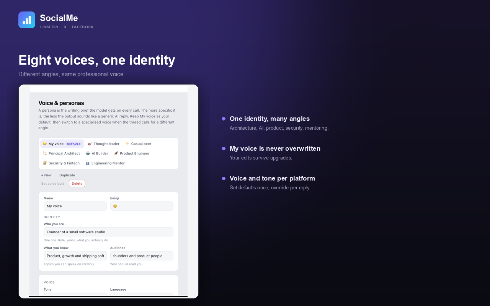
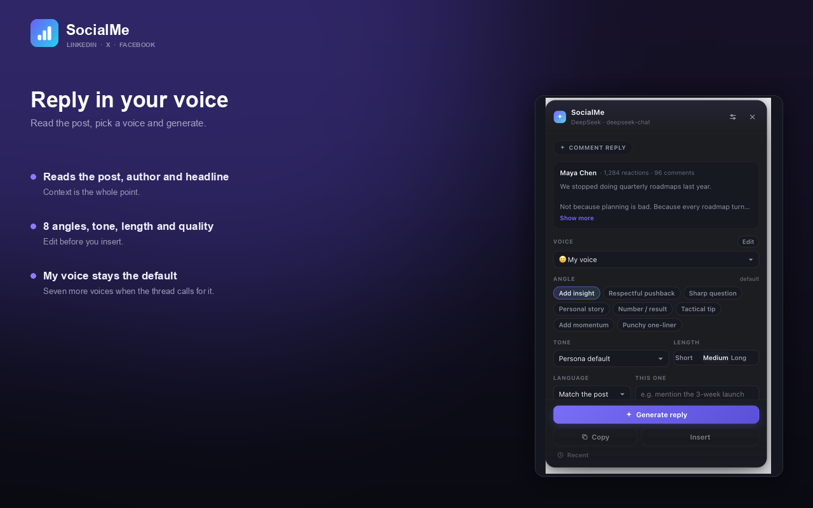

# SocialMe

**Comments, message replies and LinkedIn connection notes in your own voice.**

<p align="center">
  
</p>

<p align="center">
  Chrome Manifest V3 · LinkedIn · X · Facebook · bring your own API key
</p>

<p align="center">
  
</p>

Free and open source. No account, no telemetry, no server. Keys stay in your browser.

**[Install](#install-2-minutes)** · **[Screenshots](#screenshots)** · **[What's new in 0.8.3](#new-in-083)** · **[Releases](../../releases)**

---

## What it does

### New in 0.8.3

**Connection notes, in your voice**

- **Draft note on every invitation editor:** a labelled **Draft note** action sits below LinkedIn's invitation box, including the newer component-based dialog and its shadow-root variant. Pick a voice and tone, add an optional rough thought, review the draft, then send it yourself.
- **The field's real limit:** prompts and insertion read the field's own limit or the nearby character counter — 200 on the standard invitation form — instead of assuming 300. A counter overrides a misleading label.
- **Never mistaken for a comment:** the action is found from its invitation heading, ARIA label or counter, and excluded from comment, new-post and hidden-field detection.
- **Review before it replaces anything:** existing text is never overwritten silently; replacement asks for review and keeps Undo.

**Fixed in 0.8.3**

- The ✦ no longer drifts out of X's media row — it anchors at the native 36px size and retries until the row exists.
- Length instructions are honoured when they conflict with the platform default.
- Storage writes are serialised, and a malformed backup is rejected instead of replacing your settings.
- Provider host access is requested at runtime from **Test connection** / **Load models**, and catalogues are read with pagination.
- Invitation editors inside open shadow roots or closed components are reached without new permissions.

**Verified**

- **215 checks pass:** 100 logic, 42 provider/e2e, 62 reliability, 11 LinkedIn-note fixtures.
- Live in Brave: an unsent 179/200-character note was generated and inserted, then cleared. **No invitation was sent.**

### New in 0.8.2

- **Provider model dropdowns:** load the catalogue returned by each provider, refresh it, and retain your saved selection. Custom endpoints can still use a manual model ID. Gemini and Anthropic pagination and Ollama’s native catalogue are supported.
- **Shared voice guide:** preview and apply the supplied engineering communication guide in Voice. Your real samples, proof and provider settings are preserved; guide examples remain labelled illustrations.

### New in 0.8.1

- **My rough thought:** add your point before generating, in the inline menu, full panel or voice preview. The model is instructed to preserve your opinion, qualifications and uncertainty; style and angle choices must not replace it.
- **Source → reply examples:** approve a post or message together with your edited reply. Add examples directly in Voice without a provider key, or save them from a reply. Relevant pairs are selected for future prompts as style references, never as factual proof.
- **Control your examples:** inspect and remove pairs in Voice or Assistant. Backups include them. Message pairs are used only in message replies; at most two pairs are included in each request.

### New in 0.8

- **Assistant home:** start a three-conversation session, save threads and manage a local follow-up queue. Progress counts your explicit reviews, not inferred posts or growth.
- **A more personal voice:** My voice examples and identity carry across topic voices. Starter examples are illustrations, never your experience. No forced clever takes, brand connections, closing questions or padded replies.
- **Voice calibration:** choose formality, contractions and question frequency. Approve feedback below a draft, try a rewrite, or save an edited reply as a style example. Manage saved feedback in Assistant.
- **Relevant brand context:** use it when relevant, restrict replies to your topics, or switch it off. Forbidden claims always remain in force.
- **Visible conversation suggestions:** open SocialMe without a selected post to see up to five readable posts, ranked by matching topic words. Nothing is crawled or sent to a model for these hints.
- **Per-platform pause:** pause or resume assistance from the panel or Assistant settings.
- **Follow-ups stay local:** they appear when you open SocialMe; no messages or notifications are sent automatically. Paste a direct conversation link when the platform does not expose one.

| | |
|---|---|
| 💬 **Comment replies** | A ✦ in every comment box. Preview the source context, generate a reply, then replace existing text with review and Undo. |
| 🧵 **Reply to a comment** | The ✦ in a reply box answers that person, not the post — so threads actually continue. |
| ✉️ **DM replies** | Reads the last 1, 3 or 12 messages and answers the most recent one. |
| 🔗 **Connection notes** | Drafts a LinkedIn invite note from the recipient context, within the editor's actual character limit. |
| 🎭 **Eight voices** | `My voice` is the default; switch to Thought leader, Principal Architect, AI Builder and more. |
| 🎚️ **Voice + tone in one click** | The ✦ menu has a voice selector, tone chips and an optional instruction. |
| 🧠 **Full panel** (`⌘⇧A`) | Eight angles, tone, length, language, context checks, refinement and recent drafts. |
| 🏷️ **Brand + voice** | Positioning, pillars, proof, POV, writing samples and banned words. It sounds like you. |
| 📏 **Guardrails** | Character caps, no cliché openers, no invented facts, no engagement bait, no forced emoji. |
| 🛡️ **Sending controls** | Human-paced typing, shared hourly/daily limits across tabs, warning detection, auto-send off by default. |
| 🔌 **Your provider** | OpenAI, DeepSeek, OpenRouter, Gemini, Anthropic, Ollama or any OpenAI-compatible endpoint. |
| 🔒 **Local-first** | Data stays in `chrome.storage.local`; model requests go to your selected provider. Back up settings, voices, drafts and usage without keys. |
| 🩺 **Diagnostics** | Composer health for LinkedIn, X and Facebook plus a per-page scan when a platform changes. |

## Screenshots

Every image below is a real screen from this build, used for the Chrome Web Store listing.

### One click on every surface

<p align="center">
  
</p>

Comment on a post, reply to a comment, answer a DM, or write a LinkedIn invite note. Same icon,
same voice, in the composer you are already using.

### Voice and tone in one click

<p align="center">
  
</p>

Pick the voice and the tone, add an instruction such as “mention the 2-week launch”, then Generate.
The draft lands in the box; you edit it and press Comment yourself.

### Eight voices, one identity

<p align="center">
  
</p>

| Voice | Best for | Tone |
|---|---|---|
| 🙂 My voice | Default, natural comments | Direct and practical |
| 🎯 Thought leader | Architecture, strategy, leadership | Analytical and precise |
| ⚡ Casual peer | Developer conversations, informal threads | Warm and conversational |
| 🏗️ Principal Architect | System design, scalability, trade-offs | Analytical and precise |
| 🤖 AI Builder | Agents, MCP, integrations, automation | Direct and practical |
| 🚀 Product Engineer | Product thinking, startups, business impact | Confident and bold |
| 🔐 Security & Fintech | Payments, crypto, security, reliability | No-nonsense technical |
| 👥 Engineering Mentor | Career growth, mentoring, engineering culture | Humble and curious |

`My voice` is never overwritten by an upgrade. Your edits and user-created voices survive.

[How the voices work](https://github.com/shahzadafridi/socialme/wiki/Voices) ·
[Ready-to-paste examples](https://github.com/shahzadafridi/socialme/wiki/Voice-examples)

### The full panel

<p align="center">
  
</p>

`⌘⇧A` on a post opens the panel: eight angles, tone, length, language, context checks,
draft refinement, regenerate with rejected drafts, and recent history.

## Install (2 minutes)

1. Download the latest `socialme-<version>-chrome.zip` from [Releases](../../releases) and unzip it
   somewhere permanent.
2. Open `chrome://extensions` → enable **Developer mode** → **Load unpacked** → select that folder.
3. Click the extension → **Settings** → paste an API key (DeepSeek is the cheapest).
4. In **Brand**, fill *Positioning* and *Content pillars*. That is what makes it sound like you.
5. Reload any LinkedIn / X / Facebook tab.

## Use it

- **Comment** on a post → **✦** → pick a voice and tone → Generate → edit → press Comment.
- **Reply to a comment** → **✦** in that reply box → it answers the commenter.
- **Open a DM** → **✦** in the message toolbar → it answers the last message.
- **Send a connection request** → **Add a note** → **Draft note** → a note in your voice, kept
  inside the field's own limit (200 characters on the standard invitation form).
- **⌘⇧A** opens the panel for angles, tone, length, refinement and context checks.

## Safety and privacy

- Sending is manual by default. Auto-send is opt-in and capped.
- Human-paced typing with punctuation pauses; optional fast/careful profiles.
- Hourly and daily caps, minimum gap between actions, and a pause when the platform shows a warning.
- No analytics, no account, no backend. Only your chosen AI provider receives the request.
- Export/import settings and voices as JSON; API keys are excluded on purpose.
- Existing drafts survive generation errors or cancellation. Replacement offers review and Undo.
- Limits count automatic send attempts and observed manual sends of assisted drafts; unknown delivery is labelled clearly. They do not guarantee account protection.
- In Settings → Voice, try your voice on a sample post and explicitly save your edited reply as a writing sample.
- The panel offers Shorter, More direct, Less polished and Keep my wording, with context-based wording checks rather than a quality score.
- Custom provider hosts request optional access through **Test connection** or **Load models / Refresh models**.

## Documentation

The manual lives in the **[wiki](https://github.com/shahzadafridi/socialme/wiki)**:

- [Voices](https://github.com/shahzadafridi/socialme/wiki/Voices) ·
  [Voice examples](https://github.com/shahzadafridi/socialme/wiki/Voice-examples)
- [Scope](https://github.com/shahzadafridi/socialme/wiki/Scope) ·
  [Architecture](https://github.com/shahzadafridi/socialme/wiki/Architecture) ·
  [Testing](https://github.com/shahzadafridi/socialme/wiki/Testing) ·
  [Publishing](https://github.com/shahzadafridi/socialme/wiki/Publishing) ·
  [Contributing](https://github.com/shahzadafridi/socialme/wiki/Contributing)
- [Privacy policy](./PRIVACY.md)

## Releases

| Version | Focus |
|---|---|
| [v0.8.3](https://github.com/shahzadafridi/socialme/releases/tag/v0.8.3) | Connection notes in the invitation editor, real character limits, review before replace |
| [v0.8.2](https://github.com/shahzadafridi/socialme/releases/tag/v0.8.2) | Provider model dropdowns, shared voice guide |
| [v0.8.1](https://github.com/shahzadafridi/socialme/releases/tag/v0.8.1) | My rough thought, source → reply examples |
| [v0.8.0](https://github.com/shahzadafridi/socialme/releases/tag/v0.8.0) | Assistant home, voice calibration, per-platform pause |
| [v0.7.2](https://github.com/shahzadafridi/socialme/releases/tag/v0.7.2) | X reply icon anchored in the real composer row |

Each release carries the exact `socialme-<version>-chrome.zip` that was built and verified.
`npm run test:logic` covers the logic, provider, reliability and LinkedIn-note suites;
`npm run test:all` adds the extension e2e and live fixture flows.

## Development

```bash
npm install
npm run build      # -> dist/chrome-mv3
npm run test:all   # logic + extension e2e + live flow
```

## Support

If SocialMe saves you time, you can
[buy me a coffee](https://wise.com/pay/business/shahzadahmadltd). I put it towards charity work —
helping people in need with essentials.

Starring the repo helps too, and so does telling me which platform broke first.

MIT licensed. Not affiliated with LinkedIn, X, Meta or any AI provider.
